<div align="center">



<br />

# ⚔️ ShardForge ✨
### *Pure Live 5eTools Website to Shard Tabletop `.docx` Studio*

[](https://www.typescriptlang.org/)
[](https://react.dev/)
[](https://github.com/5etools-mirror-3/5etools-src)
[](https://www.shardtabletop.com/)

<p align="center">
  <b>No messy JSON copy-pasting. No offline dummy templates.</b><br/>
  Open the real <b>5eTools</b> website right inside the app, click any <b>Monster, Spell, Item, Class, Feat, Race, Background, or Adventure</b>, and download a clean, Shard Tabletop–ready <code>.docx</code> in one click! 🎲📜
</p>

</div>

---

## ✨ Why ShardForge?

Importing content into **Shard Tabletop** works best through structured Microsoft Word (`.docx`) files with strict heading levels (`H1`, `H2`, `H3`), 6-column ability tables, and clean SRD dice wording. Meanwhile, **5eTools** stores data in deeply nested JSON files full of `{@atk mw}`, `{@damage 2d6 + 4}`, and `{@dc 15}` tags.

**ShardForge** bridges them effortlessly:

| Feature | How It Works in ShardForge |
| :--- | :--- |
| 🌐 **Embedded Live 5eTools Website** | Streams and proxies the official `5etools-2014-src` & `5etools-src` mirror directly inside your workspace with zero ad clutter. |
| ⚡ **1-Click `.docx` Bridge** | Click any statblock, spell, item, or class in 5eTools—ShardForge extracts the live `window.dbg_page` entity + progression tables automatically. |
| 🧹 **Automatic `{@tag}` & Dice Cleanup** | Converts `{@atk mw}`, `{@hit 9}`, `{@damage 2d10 + 5}`, `{@dc 17}`, and `{@recharge 5}` into clean prose that Shard Tabletop's *Convert* engine recognizes. |
| 📚 **Multi-Entry Book Queue** | Browse across Monsters, Spells, Items, and Classes, click **`+ Add to Book`**, and export a single multi-chapter `.docx` compendium ready for Shard's **Convert Children**. |
| 🖋️ **Custom Word Heading Mapper** | Customize `H1`–`H4` heading levels, 6-column vs. inline ability scores, dice averages, and book fonts (`Cambria`, `Georgia`, `Calibri`) with live manuscript preview. |

---

## 🎬 How the Workflow Looks

```
┌─────────────────────────────────────────┐       ┌─────────────────────────────────────────┐
│ 🌐 1. Browse Live 5eTools Website       │       │ 📜 2. Live Shard .docx Manuscript       │
│                                         │       │                                         │
│  [Bestiary] [Spells] [Items] [Classes]  │       │  Word H1 · Shard Monster Entry          │
│  ─────────────────────────────────────  │       │  Adult Red Dragon                       │
│  ► Adult Red Dragon (MM)                │ ───►  │  Huge dragon, chaotic evil              │
│    Barbarian (PHB + Subclasses)         │ Syncs │  ┌─────┬─────┬─────┬─────┬─────┬─────┐  │
│    Fireball (PHB)                       │ Live! │  │ STR │ DEX │ CON │ INT │ WIS │ CHA │  │
│    Vorpal Sword (DMG)                   │       │  │ 27  │ 10  │ 25  │ 16  │ 13  │ 21  │  │
│                                         │       │  └─────┴─────┴─────┴─────┴─────┴─────┘  │
│         [ + Add to Book ] [ .docx ⬇ ]   │       │  Word H2 · Actions & Legendary Actions  │
└─────────────────────────────────────────┘       └─────────────────────────────────────────┘
```

1. **Pick a Category**: Click **Bestiary**, **Spells**, **Items**, **Classes**, **Feats**, **Races**, **Backgrounds**, or **Adventures** in the top bar of the 5eTools pane (supports both **2014** and **2024 / Latest** rulesets).
2. **Select Any Entry**: Click any item in the 5eTools list. For **Classes**, you can also toggle on any **Subclasses** inside 5eTools and ShardForge will include both the 1–20 Class Progression Table and your active Subclass features!
3. **Download `.docx` or Bundle a Book**:
   - Click **`Download .docx`** for an immediate standalone Word file.
   - Or click **`+ Add to Book`** on multiple entries and click **`Export Book (.docx)`** in the top-right corner.

---

## 📥 How to Import Your `.docx` into Shard Tabletop

1. Open **[Shard Tabletop](https://www.shardtabletop.com/)** and go to your **Library**.
2. Click **New Book** → **Import Book** and select the `.docx` file downloaded from ShardForge.
3. Open your imported book in **Edit Mode**:
   - **For a Single Entry**: Click the menu icon (`☰`) next to the entry heading (`H1`) and click **Convert**.
   - **For a Multi-Entry Book**: Click the menu icon (`☰`) next to a Category Chapter heading (`H1`, e.g., *Monsters & NPCs* or *Spells*) and click **Convert Children** to model every entry in that chapter at once!

---

## 💻 Local Setup (Run on Your Computer)

### Prerequisites
- **[Node.js](https://nodejs.org/)** v18+ (v20 or v22 recommended)
- **Git** installed on your machine

### Step-by-Step Commands

```bash
# 1. Clone your repository
git clone https://github.com/YOUR_USERNAME/shardforge.git
cd shardforge

# 2. Install dependencies
npm install

# 3. Start the full-stack server (Express 5eTools Proxy + Vite React UI)
npm run dev
```

Now open **`http://localhost:3000`** in your browser! 🎉

---

## 🚀 Tutorial: How to Push to GitHub & Deploy Online

Because **ShardForge** uses an Express backend (`server.ts`) to reverse-proxy the live 5eTools website and inject the 1-click `.docx` bridge without CORS blocks, here is how to upload it to GitHub and deploy it live for free!

### Part 1: Upload This Project to Your GitHub Repository 🐙

1. Go to **[github.com/new](https://github.com/new)** and create a new repository (for example, `shardforge`).
   - Leave *"Add a README file"* **unchecked** (since this project already has one!).
2. Open your terminal inside the project folder and run:

```bash
# Initialize Git (if not already initialized)
git init

# Stage all project files
git add .

# Create your first commit
git commit -m "feat: initial release of ShardForge 5eTools to Shard .docx studio"

# Set branch to main and link your GitHub repo
git branch -M main
git remote add origin https://github.com/YOUR_USERNAME/shardforge.git

# Push to GitHub!
git push -u origin main
```

---

### Part 2: Deploy Your Full-Stack App (3 Easy Options) ☁️

> **Important Note**: *GitHub Pages* only hosts static HTML files and cannot run `server.ts` (the live 5eTools reverse proxy). To keep the embedded 5eTools website working online, deploy your GitHub repo to one of these free Node.js hosts in 2 minutes:

#### 🌟 Option A: Deploy on Render.com (Free & Easiest)
1. Sign in to **[render.com](https://render.com/)** with your GitHub account.
2. Click **New +** → **Web Service** and select your **`shardforge`** GitHub repository.
3. Configure the settings:
   - **Runtime**: `Node`
   - **Build Command**: `npm install && npm run build`
   - **Start Command**: `npx tsx server.ts`
   - **Environment Variables**: Add `NODE_ENV` = `production`
4. Click **Create Web Service**. Render will build your app and give you a live `https://shardforge.onrender.com` URL!

#### 🚂 Option B: Deploy on Railway.app (1-Click from GitHub)
1. Sign in to **[railway.app](https://railway.app/)** with GitHub.
2. Click **New Project** → **Deploy from GitHub repo** → choose **`shardforge`**.
3. In **Settings** → **Deploy**:
   - **Build Command**: `npm run build`
   - **Start Command**: `npx tsx server.ts`
4. Under **Networking**, click **Generate Domain** to get your public URL!

#### 💻 Option C: Run Directly Inside GitHub Codespaces (Zero Setup!)
Want to run it right inside GitHub without setting up a server?
1. Open your repository on GitHub.
2. Click the green **`<> Code`** button → switch to the **Codespaces** tab → click **Create codespace on main**.
3. Inside the Codespace terminal, run:
   ```bash
   npm install && npm run dev
   ```
4. GitHub Codespaces will pop up a button to **Open in Browser** on port `3000`—and you can convert `.docx` files straight from your browser!

---

## 🗂️ Project Structure

```text
shardforge/
├── public/
│   └── shardforge-banner.svg       # Animated SVG banner for GitHub README
├── src/
│   ├── components/
│   │   ├── LiveFiveEToolsFrame.tsx # Embedded 5eTools viewport + ruleset switcher
│   │   ├── DocxPreviewSheet.tsx    # Live Word manuscript, heading tree & tag diff
│   │   └── StyleInspectorPanel.tsx # Multi-entry Book Queue, H1-H4 mapper & guide
│   ├── types/
│   │   └── converter.ts            # AST & Shard formatting TypeScript interfaces
│   ├── utils/
│   │   ├── fiveEToolsParser.ts     # Parses live window.dbg_page JSON + 5eTools DOM
│   │   ├── tagParser.ts            # Strips {@atk}, {@damage}, {@dc}, {@hit} tags
│   │   └── docxGenerator.ts        # Builds OpenXML (.docx) files via `docx`
│   ├── App.tsx                     # 3-zone top bar & split-screen workspace
│   └── index.css                   # Archival ink tokens & blur-logo animations
├── DESIGN.md                       # Tabletop sourcebook color & typography tokens
├── server.ts                       # Express live 5eTools mirror proxy & bridge injector
└── package.json
```

---

<div align="center">
  <sub>Crafted for D&amp;D 5e Game Masters &amp; Shard Tabletop Builders 🎲✨</sub>
</div>
